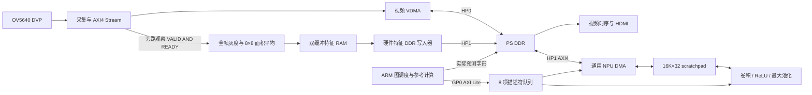

# NPU 架构与硬件编程契约

本文描述本仓库实际 RTL。器件为 XC7Z020-2，处理器为 Cortex-A9，软件运行在裸机 standalone BSP。它是可配置的标量 INT8 推理引擎；吞吐与延迟以板上测量记录为准。

## 1. 数据通路

原有视频 VDMA 保留 HP0，NPU 及特征写入器共享 HP1。特征 tap 不驱动 TREADY；像素只在 `pixel_valid && pixel_ready` 时被接受，避免对视频施加额外背压。摄像头、VDMA 和 tap 的 TDATA/TVALID/TREADY/TUSER/TLAST 必须接到同一组实际网络。

## 2. 模块边界与时钟

| 模块 | 作用 | 接口 |
|---|---|---|
| npu_top100.v | Vivado module reference 的 Verilog 顶层 | AXI Lite 从接口、AXI4 主接口、IRQ |
| npu_axi_v2.sv | MMIO、暂存描述符、队列、BRAM、执行器仲裁 | 128 KiB MMIO |
| npu_compute.sv | 可运行时配置的标量算子与地址流水线 | 单个同步 RAM 端口 |
| npu_dma.sv | DDR 与 scratchpad 间自动搬运 | AXI4 32 bit INCR |
| npu_frame_preprocess.sv | 全帧检查、灰度、缩小与归一化 | 被动像素 tap、双特征读口 |
| npu_feature_writer.sv | 将 64 字节特征写入 DDR，再发布序号 | AXI 写通道 |
| npu_video_ddr.v | 预处理与特征写入器的 MMIO 顶层 | 4 KiB MMIO |

预处理使用 FCLK0 100 MHz；优化后的 NPU 使用独立 FCLK3 100 MHz，具体实现是否可部署须由整机 setup/hold、时钟覆盖及 bus-skew 检查决定。视频 FCLK2 保持 50 MHz，为原视频时钟向导供时。HDMI 像素时钟为 75 MHz，输出刷新率和摄像头采集帧率是两个指标。

## 3. 存储组织和所有权

Scratchpad 是 16384 个 32 位字，即 64 KiB，复位不清内容。INT8 张量每个元素占一个字，低 8 位为二补码；输出将该字节符号扩展到 32 位。偏置占一个 INT32 字。它不是 64 KiB 紧密排列的 INT8 容量。

计算核、DMA、CPU 共享一个同步 BRAM 端口。计算核与 DMA 按同一队列串行执行，互斥持有端口。已有执行或排队任务时，CPU 访问 scratchpad 返回 SLVERR；CPU 必须在 `busy=0 && queue_count=0` 时进行调试读写。

| 模型用途 | scratch 字索引 | 元素数 |
|---|---:|---:|
| 输入 8×8×1 | 0 | 64 |
| 第一层权重 | 64 | 72 |
| 第一层偏置 | 144 | 8 |
| 最后一层权重 | 160 | 1280 |
| 最后一层偏置 | 1440 | 10 |
| 卷积输出 | 2048 | 512 |
| 池化输出 | 2560 | 128 |
| 分类 logits | 2816 | 10 |

当前应用的 DDR 分区：应用及其静态数据从 0x00100000 起，链接区结束于 0x01000000；三张 RGB888 视频帧从 0x01000000 起，每帧 2764800 字节；硬件特征 mailbox 为 0x04000000 和 0x04000040，各 64 字节。不能让堆、栈或其他 DMA 缓冲占用这些区域。

## 4. NPU MMIO

基地址 `0x43c20000`，范围 128 KiB，32 位对齐访问。所有偏移均以字节计。

| 偏移 | 名称 | 行为 |
|---|---|---|
| 0x00 | ID | 0x4e505532 |
| 0x04 | CONTROL | bit0 允许派发，bit1 IRQ 使能 |
| 0x08 | STATUS | bit0 忙，bit1 队列满，bit2 最近任务错误，bit3 队列空，bit4 IRQ pending |
| 0x0c | COMPLETED | 已完成任务数，包含失败任务，模 2^32 |
| 0x10 | SUBMIT | 写 1 原子复制暂存描述符入队 |
| 0x14 | LAST_TAG | 最近完成任务的 word14 |
| 0x18 | LAST_ERROR | 最近任务错误码 |
| 0x1c | LAST_CYCLES | 最近任务执行周期数 |
| 0x20 | ERROR_COUNT | 累积失败次数，模 2^32 |
| 0x24 | QUEUE_COUNT | 等待派发任务数 |
| 0x28 | IRQ_PENDING | 读 pending；写 1 应答 |
| 0x2c | RAM_WORDS | 16384 |
| 0x30 | CLOCK_HZ | NPU 标称时钟 Hz |
| 0x100..0x13c | STAGING | 16 个 32 位描述符字 |
| 0x10000..0x1ffff | RAM | scratchpad 的 CPU 窗口 |

队列有 8 个等待槽，另有 1 个正在执行的任务。暂存区可在执行期间更新，提交时复制；提交方必须串行独占设备。关闭派发不会中止当前任务。完成记录仅保留最近一项；累计错误计数可检测已被后续成功任务覆盖的失败。控制、提交和 IRQ 应答要求全部字节 strobe；RAM 和暂存区支持 byte strobe。不支持的地址、未对齐访问、非法写或忙时 RAM 访问返回 SLVERR。

## 5. 计算描述符和数值语义

| word | 含义 |
|---|---|
| 0 | opcode：1 卷积、2 ReLU、3 最大池化；bit8 为卷积融合 ReLU |
| 1 / 2 | 输入 / 输出 scratch 字索引 |
| 3 / 4 | 权重 / 偏置字索引；偏置 0xffffffff 表示禁用 |
| 5 / 6 / 7 | 输入 W / H / C，各 1..256 |
| 8 | 卷积输出通道 1..256 |
| 9 / 10 | kernel W / H，各 1..7 |
| 11 | stride：1、2、4 |
| 12 | 四边相同 padding：0..3 |
| 13 | 卷积算术右移 0..31；ReLU/池化必须为 0 |
| 14 | 软件 tag |
| 15 | 保留为 0 |

输入/输出布局为 HWC：`((y*W+x)*C+c)`。权重布局为 `[out_c][ky][kx][in_c]`。输出空间尺寸为 `floor((input+2*pad-kernel)/stride)+1`。ReLU 保留原形状。

卷积先装入有符号 INT32 偏置或 0，再执行有符号 INT8×INT8 累加。累加按 INT32 二补码回绕，随后算术右移、可选 ReLU，最后饱和到 [-128,127]。零填充位置不执行 MAC。池化忽略填充位置，等价于填充值 -128；窗口全为填充时输出 -128。

输出不能与输入、权重或启用的偏置范围重叠。所有使用的跨度必须完整处于 scratch 内。形状/opcode 无效返回 error=1，范围/重叠无效返回 error=2，非法内部状态返回 error=3。无效配置不写输出。

地址执行流水线分为 GEO、ROW、ADDR，再发起同步输入读取；卷积在 XGET 同时请求权重，在 WGET 累加并推进迭代。描述符跨度乘法单独分阶段验证，避免将多级乘法串在单周期关键路径。当前结构每次最多一个 MAC；5888 次 MAC 不等于 5888 个总执行周期。

## 6. DDR DMA 描述符

word0 为 0x10 加载或 0x11 回写，bit8=1 表示 packed INT8；word1 为 DDR 字节地址，word2 为 scratch 字索引，word3 为元素数，word14 为 tag，其余字全为 0。完整 32 位字段先验证，再截取内部位宽，防止高位非法值被截断后误接受。

DDR 起始必须四字节对齐，并在 [0x00100000,0x20000000) 内。raw 模式每元素传 4 字节，packed 模式每字节一元素，加载时符号扩展；搬运涉及 `ceil(elements/4)*4` 的对齐 DDR 范围。scratch 总跨度不超过 16384 字。packed 回写尾拍使用 WSTRB，只修改有效字节。

AXI4 使用 32 位、INCR、每 burst 最多 16 拍；到达 4 KiB 边界时拆分。AW/W、AR/R、B 通道遵循各自握手，背压期间保持有效负载稳定。配置校验在原子采样后执行，校验通过前不发 AXI 请求。错误位：1 配置，2 RRESP，4 BRESP，8 RLAST 不符，16 内部非法状态。错误后部分结果全部视为无效。

已接收的读 burst 遇到错误会继续 drain 至 RLAST；提前 RLAST 被报错后可以重新接受任务。AXI 从端无限不响应时，软件超时不会凭空取消已在途事务，必须保留缓冲所有权，必要时复位系统。

## 7. 全帧预处理与发布协议

固定 1280×720，每块 160×90 像素，对应一个 8×8 元素。灰度为 `(R+2G+B)>>2`，白底黑字模式默认取 `255-gray`。对每块全部像素累加，输出 `round(sum*112/(160*90*255))`，取值 0..112。32 周期迭代除法避开像素关键路径。每个有效像素都参与面积平均，没有抽样或跳帧。

检查 SOF、每行 EOL、像素数与完整帧边界；非法帧不发布。两个特征 bank 分别提供 CPU 诊断读口和 DMA 写入器读口。写入器将 64 字节打包成 16 个 AXI 数据拍，只有成功收到 B 响应且源序号仍有效时才推进 published sequence。

预处理 MMIO 基址 `0x43c40000`，4 KiB：

| 偏移 | 含义 |
|---|---|
| 0x00 | ID=0x50524532 |
| 0x04 | DDR 中已发布的序号 |
| 0x08 | 最近完整帧像素数，应为 921600 |
| 0x0c | 源帧错误加 writer 错误 |
| 0x10 | 收到的 SOF 数 |
| 0x14 | bit0 反相，帧起始锁存 |
| 0x18 | CPU 已消费序号 ACK |
| 0x1c | 生产者领先 ACK 超过两个 bank 的次数 |
| 0x20 | published sequence != ACK |
| 0x24 | 从输入 SOF 到特征 DDR 成功发布的 100 MHz 周期数 |
| 0x28 | mailbox 基地址 0x04000000 |
| 0x2c | writer 错误数 |
| 0x30 | 源预处理完成序号 |
| 0x100..0x1fc | bank0，64 个字，每字低 8 位有效 |
| 0x200..0x2fc | bank1，同上 |

序号 s 对应 bank `(s-1)&1`，DDR 地址为 `0x04000000+bank*64`。CPU 失效对应 cache line，读取并核对诊断口；推理完成后才 ACK。published 序号连续、前后稳定、无 overrun 是无跳帧验收的一部分。ACK 不会停止生产者；软件必须在 bank 被重用前消费完成。

## 8. 模型及显示

模型结构：8×8×1 → 3×3 Conv/8/pad1 + ReLU → 2×2 MaxPool/stride2 → 4×4 Conv/10 → argmax。第一层右移 8，最后一层右移 9，每次推理共 5888 次 MAC。权重和偏置初始化时通过四个 DMA 任务装入；每帧执行输入 DMA、卷积、池化、分类卷积、输出 DMA 共五项任务。

训练使用 sklearn 随包 UCI optical digits，共 1797 个真实样本；固定种子分层划分 train1221 / validation216 / test360。浮点测试 96.67%，量化测试 349/360=96.94%。该数据集评分不能替代摄像头实景准确率。

ARM 同步核对独立参考输出，并将实际 argmax 的数字绘制到已完成 RGB888 帧左上角。5×7 字形放大八倍为 40×56 像素，白字黑底。视频区按 section 配置为 normal noncache，采用对齐 32 位写入。模型输入取自显示叠加之前的摄像头 tap，因此字形不会反馈到识别输入。叠加表示最近完成的预测；显示刷新时刻另有视频缓冲和扫描等待。

## 9. 验证与扩展约束

验证覆盖：算子数值与溢出、形状/跨度、AXI Lite 独立 AW/W 与背压、队列/BRAM 互斥、DMA 双向 raw/packed、4 KiB 拆分和错误恢复、完整 720p 特征、特征 DDR 发布顺序、完整模型 logits、逐帧参考与视频健康。

实际摄像头初测 28.587318 fps，约 34.98 ms/帧。严格延迟统计包含从 SOF 到 DDR 特征发布，再到 CPU 对比及叠加写完；它不等于光子到屏幕显示延迟。最终通过状态、持续帧数、最大延迟、时序与产物 SHA 以验证报告为准。

扩展模型前须确认 scratch 容量、HWC/权重布局、每层量化参数和独立测试 logits。没有硬件 softmax、浮点、通用 ONNX 解释器或多路并行 MAC。需要更高吞吐时，可增加流水并行 MAC 和多 bank 存储，但必须重新验证数值、仲裁及整机时序。
